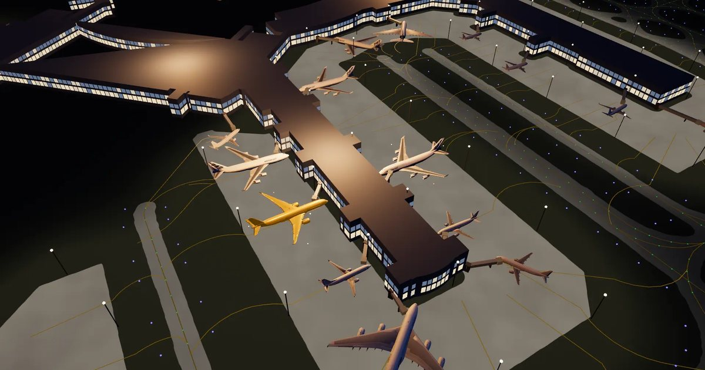

# SKYCONTROL

**Air traffic control at San Francisco, by voice, in the browser.** You are SFO's ground, tower or approach controller:
key the mic and talk, the pilots read back and fly what you said.

**Play:** https://openatc.aeon-labs.site · **Learn the ropes:** https://openatc.aeon-labs.site/learn



Everything that listens, understands or speaks runs on small models built for this game, on a CPU server, in the
browser and in the phone app. No large language model and no GPU at run time.

## How a transmission flows

```
mic ─▶ speech to text ─▶ clean-up rules ─▶ command parser ─┬─▶ safety gate ─▶ send / ask to confirm / "say again"
       ATC-ASR 110M      asr-repair.ts     commands.ts     └─ if the rules fail: command model S1 (2M, in the browser)
                                                                                        │
pilot readback ◀── pilot voice (Paradee 8M, in the browser) ◀── phraseology.ts ◀── game engine
```

The model only ever writes a typed command line (`UAL214 C 5000`), which the game's own parser turns into a command;
it never touches game state directly.

## Models

| model | what it does | runs | numbers |
|---|---|---|---|
| [SkyControl ATC-ASR 110M](https://huggingface.co/srinath-exe/skycontrol-atc-asr-110m) | speech to text, fine-tuned on ATC radio | server CPU (sherpa-onnx), ~0.2 s | 0.6 % word errors on real recordings, 0.8 % on 805 unseen lines |
| [SkyControl command model S1-2M](https://huggingface.co/srinath-exe/skycontrol-atc-command-2m) | what you said → the command | browser worker, int8, 0.1–0.2 s | 51 of 60 right and 2 wrong on an independent exam in everyday wording |
| safety gate | send, ask to confirm, or "say again" | browser, < 1 ms | 108 of 115 non-commands not sent |
| Paradee-8M (third party) | pilot voices over a radio filter | browser | |

The command model was trained from scratch on data the game generates itself (205,000 situations, 11 airports), then
tuned with GRPO using the simulator as the reward. The training code is in `ml/`.

## Run it

```bash
npm install
npm run dev               # http://localhost:3000
npm run typecheck
bash scripts/test-sim.sh tests/commands tests/engine tests/systems tests/tutor   # headless tests (node:test)
npm run test:e2e          # Playwright
```

Voice input needs the speech server (`src/app/api/voice/stt/`), which loads the ATC-ASR model from
`~/.cache/openatc-stt/` (set `OPENATC_STT_PARAKEET_DIR`); without it the game falls back to the browser's speech
recognition. Typing commands always works.

## Where things are

| path | what |
|---|---|
| `src/lib/sim/` | the game engine: aircraft, commands, phraseology, the pilot brain |
| `src/lib/voice/` | the voice chain: recogniser, clean-up rules, command model client, safety gate |
| `src/components/atc/WorldMap/` | the 3D airport (three.js), sky and weather; world data baked by `scripts/bake_world.py` |
| `src/game/` | the game UI: strips, command panel, settings, the tutorial (`Tutorial/`) |
| `src/app/` | pages: landing `/`, set-up `/start`, game `/play`, tutorial `/learn`, settings |
| `ml/` | everything trained: data generators, tokenizer, the command model, safety gate, speech and voice benchmarks |
| `mobile/` | the Flutter app (game in a WebView, on-device speech) |
| `tests/` | engine, commands, systems, tutorial (headless) and Playwright end-to-end |

## Licence

Code: MIT. Media, models and data have their own terms: see [NOTICE.md](NOTICE.md).
