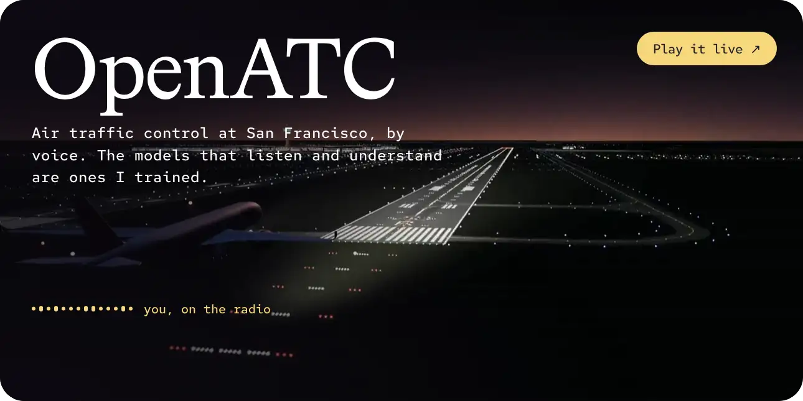
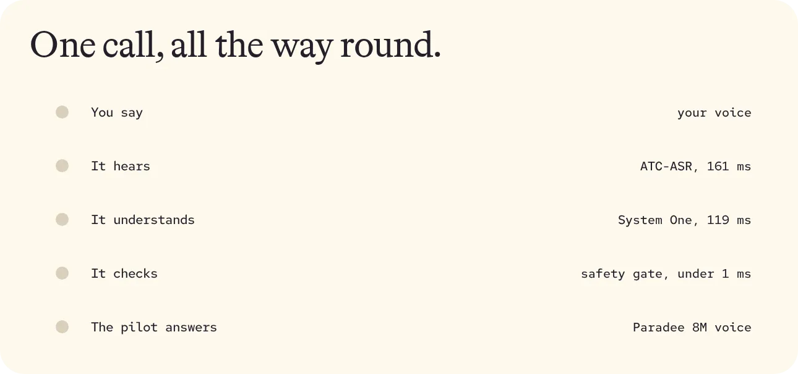
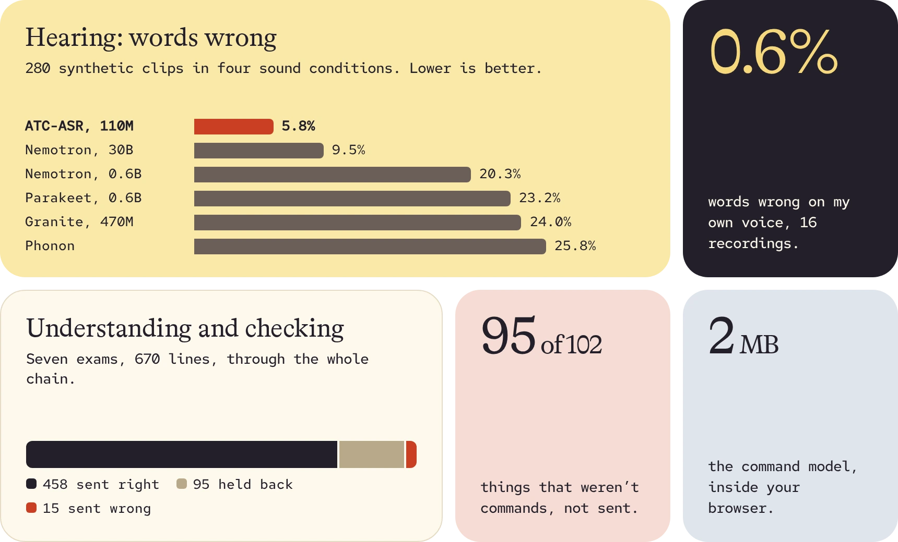

<a href="https://openatc.aeon-labs.site">
<picture>
  <source media="(max-width: 600px)" srcset=".github/readme/openatc-phone.webp">
  
</picture>
</a>

<p align="center">
  <a href="https://openatc.aeon-labs.site"></a>&nbsp;
  <a href="https://openatc.aeon-labs.site/learn"></a>&nbsp;
  <a href="https://huggingface.co/srinath-exe"></a>
</p>

You are San Francisco's ground, tower or approach controller. Key the mic and talk; the pilots read it back and fly what you said. Everything that listens, understands or speaks runs on small models, on a CPU server, in the browser or in the phone app. **No large language model and no GPU at run time.**

> OpenATC was called SkyControl until recently, so the models and some code still carry that name.

## One call, all the way round

<picture>
  <source media="(max-width: 600px)" srcset=".github/readme/pipeline-phone.webp">
  
</picture>

Rules read standard phraseology first. The command model, System One, steps in only when they can't. It writes a typed command line such as `UAL214 C 5000`, which the game's own parser checks, and it can only choose aircraft that are on frequency. It never touches game state. The safety gate then sends the command, asks you to confirm, or says "say again".

<details>
<summary>The same thing as a diagram, with the files</summary>

```
mic ─▶ speech to text ─▶ clean-up rules ─▶ command parser ─┬─▶ safety gate ─▶ send / ask to confirm / "say again"
       ATC-ASR 110M      asr-repair.ts     commands.ts     └─ if the rules fail: System One (2M, in the browser)
                                                                                        │
pilot readback ◀── pilot voice (Paradee 8M, in the browser) ◀── phraseology.ts ◀── game engine
```

</details>

## Measured

<picture>
  <source media="(max-width: 600px)" srcset=".github/readme/bench-phone.webp">
  
</picture>

<sub>The clips are synthetic speech in four sound conditions, 70 calls each, without the ten calls that overlap our training text. ATC-ASR was trained on air-traffic speech, including this voice family; the others are as released. On real radio recordings, which are much harder, the error rate is far higher. The exams run through the whole chain: clean-up, rules, System One and the safety gate. The <a href="https://huggingface.co/srinath-exe/skycontrol-atc-command-2m">model card</a> lists every exam, including where this version is worse than the first.</sub>

## The models

| model | job | runs | size | speed |
|---|---|---|---|---|
| [**ATC-ASR**](https://huggingface.co/srinath-exe/skycontrol-atc-asr-110m) | your voice to text, fine-tuned from Parakeet | server CPU | 110M weights, 131 MB | 150 ms for a five-second call |
| [**System One**](https://huggingface.co/srinath-exe/skycontrol-atc-command-2m) | what you said to a command, trained from scratch | browser worker | 2M weights, 2 MB | 110 to 170 ms |
| **Safety gate** | send, ask to confirm, or "say again" | browser | | under 1 ms |
| **Paradee 8M** (third party) | the pilots' voices, through a radio filter | browser | 8.5 MB | 6× real time |

System One learned from 205,000 situations the game generated itself, across 11 airports, with a 1,349-piece tokenizer where every air-traffic word is one piece. An earlier version then practised with GRPO against the simulator. The training code and write-ups are in [`ml/`](ml/).

## Run it

```bash
npm install
npm run dev               # http://localhost:3000
npm run typecheck
bash scripts/test-sim.sh tests/commands tests/engine tests/systems tests/tutor   # headless tests (node:test)
npm run test:e2e          # Playwright
```

Typing commands always works. Voice input needs the speech server in `src/app/api/voice/stt/`, which loads ATC-ASR from `~/.cache/openatc-stt/` (set `OPENATC_STT_PARAKEET_DIR`). Without it the game uses the browser's own speech recognition.

This repository is a snapshot from 14 November 2026. The live game is newer, and so is the System One on Hugging Face that the numbers above describe.

## Where things are

| path | what |
|---|---|
| [`src/lib/sim/`](src/lib/sim/) | the game engine: aircraft, commands, phraseology, the pilot brain |
| [`src/lib/voice/`](src/lib/voice/) | the voice chain: recogniser, clean-up rules, command model client, safety gate |
| [`src/components/atc/WorldMap/`](src/components/atc/WorldMap/) | the 3D airport (three.js), sky and weather; world data baked by `scripts/bake_world.py` |
| [`src/game/`](src/game/) | the game UI: strips, command panel, settings, the tutorial |
| [`src/app/`](src/app/) | pages: landing `/`, set-up `/start`, game `/play`, tutorial `/learn`, settings |
| [`ml/`](ml/) | everything trained: data generators, tokenizer, command model, safety gate, speech and voice benchmarks |
| [`mobile/`](mobile/) | the Flutter app: the game in a WebView, on-device speech |
| [`tests/`](tests/) | engine, commands, systems and tutorial (headless), and Playwright end-to-end |

## Licence

Code: MIT. Media, models and data have their own terms: see [NOTICE.md](NOTICE.md).

Built by [Srinath H](https://github.com/Srinath-exe). The other one: [Stratify MCP](https://github.com/Srinath-exe/stratify-mcp).
